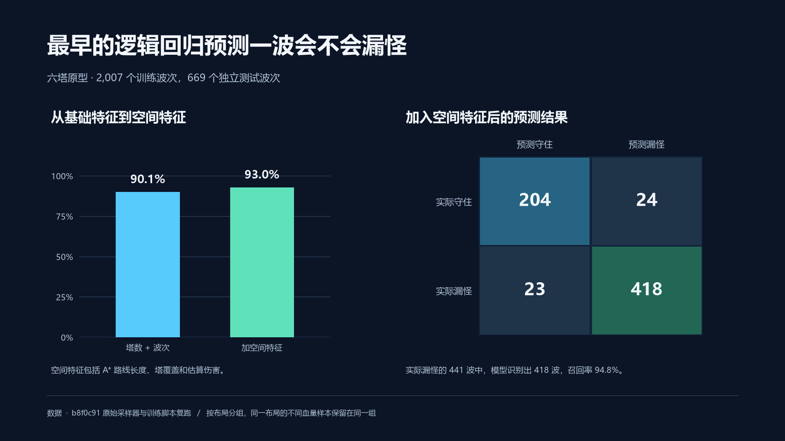
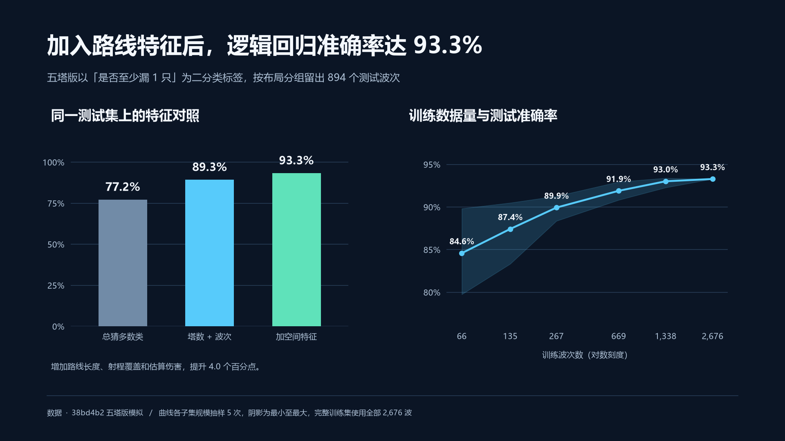
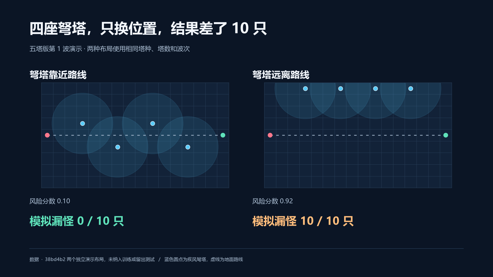

# 预测功能的技术路线与历史实验

各阶段都使用监督学习：离线运行游戏自动生成标签，训练模型建立开波前状态与结果之间的关系。自动标注不等于无监督学习，加入 CNN 也没有改变监督学习的任务性质。

## 为什么逐步改变方法

| 阶段 | 对应代码 | 要解决的问题 | 方法及选择原因 |
|---|---|---|---|
| 六塔逻辑回归 | `b8f0c91` | 先判断是否至少漏一个敌人 | 二分类输出清晰，逻辑回归训练与部署简单，适合作为基准 |
| 五塔逻辑回归 | `38bd4b2` | 适配队友的新规则，并区分同塔不同位置 | 增加路线覆盖和估算伤害等空间特征，补齐仅统计塔数所缺少的信息 |
| 初版 MLP | `3d4ce20` | 二分类不能区分漏 2 个与漏 10 个 | 回归漏怪比例，用多层网络学习数值特征的非线性组合 |
| 高速 Boss 实验 | `7454b47`、`8242a00`、`29a2e6e` | 处理减速与 Boss 场景中的误差 | 改进减速特征，并曾尝试在线模拟复核；后者属于历史尝试 |
| 纯 MLP 推理 | `c2a1595` | 预测和建议统一由学习模型给出 | 移除在线战斗模拟，枚举候选并按预计漏怪数排序 |
| CNN + MLP | `691debf` | 人工汇总的空间特征可能遗漏布局细节 | 用六通道地图学习空间表示，与数值特征融合，保留同数据 MLP 对照 |

最终部署建议通过预测模型评估候选方案，再选择塔种与格子；模型不是直接输出坐标。最终版的在线过程不运行提前战斗模拟，离线生成标签与离线效果评估仍然使用游戏引擎。

## 逻辑回归历史结果

以下两版游戏规则和测试集不同，应分别阅读。

| 版本 | 总记录 / 训练 / 测试 | 基础特征准确率 | 完整特征准确率 | 漏怪类召回率 |
|---|---|---:|---:|---:|
| 六塔原型 | 2,676 / 2,007 / 669 | 90.1% | 93.0% | 94.8% |
| 五塔版本 | 3,570 / 2,676 / 894 | 89.3% | 93.3% | 94.5% |

基础特征包含塔数与波次信息；完整特征增加路径、覆盖和估算伤害。五塔版本的多数类基准准确率为 77.2%。原始汇总、混淆矩阵与学习曲线抽样分数见 [历史数据](history-results.json)。

### 六塔逻辑回归

图对应 `b8f0c91`，仅表示六塔原型的历史结果。

### 五塔逻辑回归与训练数据量

图对应 `38bd4b2`。学习曲线固定同一个 894 条测试记录的集合，按完整布局抽取训练子集，部分规模抽样五次，展示均值与范围；100% 规模重复值对应同一套完整训练数据，不是五个独立全量实验。

### 同样的塔，位置不同

两局都是五塔版本第 1 波、四座弩塔、10 个敌人。靠近路线时实际漏怪 0 只，远离路线时漏怪 10 只。两个演示布局独立于训练和测试拆分。这个案例说明输入需要表达位置与路线的关系，不证明模型能正确判断所有布局。

## MLP 历史结果的使用范围

早期 MLP 使用 67 项数值特征和 64、32 两个隐藏层。减速特征修正后的模型在原有测试集上的漏怪数 MAE 约为 1.81 只，相关学习曲线见历史数据中的 `mlp_learning_curve`。部分小样本训练达到 100 轮上限时仍未收敛，曲线反映固定训练预算下的表现。

历史在线模拟复核曾让 47 个高速 Boss 布局中的 Boss 突破从 46 次降至 44 次。这是旧策略比较，不能作为最终 CNN + MLP 的结果。最终版的数据拆分、模型结构与评估见 [最终实验说明](experiments.md)。

## 保留与演示旧版本

提交号标识具体实验版本；旧版逻辑回归位于 `feature/wave-prediction` 的历史中，纯 MLP 位于 `feature/mlp-deployment`，最终模型位于 `feature/cnn-mlp-deployment`。分支名可能继续前进，复现实验应以提交号为准。

六塔和五塔逻辑回归属于独立的功能分支。若在远程找不到对应提交，需要项目维护者一并推送这些历史分支；它们不一定包含在最终 CNN 分支的祖先提交中。

本地六版演示包仍然保留。需要对外分享时，可将演示包作为单独的版本附件，并让「在线模拟复核」版本明确带有历史实验标识。
