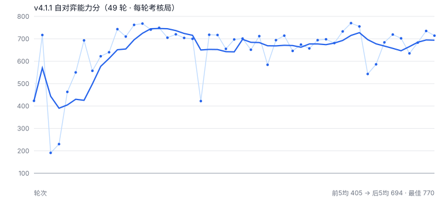

# 自对弈小模型：一个外部对照实验

> 本文记录一个**不在本仓库里**的对照实验：一个在浏览器里自己学的小网络，用来回答一个问题——
> 「在线学习能不能替代这里的监督学习？」结论是**不能并入主线**，但它的**能力分口径**被吸收进了本仓库。

## 1. 它是什么

| 项 | 值 |
|---|---|
| 结构 | 38 → 24 → 12 → 1（ReLU / ReLU / 线性） |
| 输入 | 44 维 = 30 局面特征 + 14 动作特征（含最短路长度、离路径距离） |
| 学习信号 | 1 步 TD 误差的 MSE，链式法则反传 |
| 优化 | Adam（b1 0.9 / b2 0.999，偏差修正）+ 经验回放 + 梯度范数裁剪 |
| 每轮 | 自对弈 2 局（边打边更新）+ 1 局考核（贪心，不更新） |
| 训练位置 | 浏览器内，`nn.js` + `ai.js`，与 Node 共用同一份实现 |

被评估的是**考核局**，所以曲线能反映「有没有变强」，而不是「这一局运气好不好」。

## 2. 结果



| 轮次 | 能力分 | 波次 | 击杀 | 花费 | 效率 | ε |
|---:|---:|---:|---:|---:|---:|---:|
| 1 | 423 | 4 | 26 | 320 | 1.20 | 0.94 |
| 6 | 550 | 5 | 50 | 522 | 1.03 | 0.69 |
| 11 | 743 | 6 | 62 | 662 | 1.12 | 0.51 |
| 16 | 749 | 6 | 62 | 678 | 1.11 | 0.37 |
| 21 | 422 | 4 | 26 | 338 | 1.15 | 0.27 |
| 26 | 701 | 6 | 57 | 603 | 1.15 | 0.20 |
| 31 | 714 | 6 | 58 | 630 | 1.13 | 0.15 |
| 36 | 698 | 6 | 56 | 615 | 1.13 | 0.12 |
| 41 | 543 | 5 | 48 | 538 | 1.00 | 0.12 |
| 46 | 635 | 6 | 51 | 585 | 1.07 | 0.12 |
| 49 | 714 | 6 | 58 | 652 | 1.10 | 0.12 |

共 **49 轮**：前 5 轮均值 **404.8** → 后 5 轮均值 **693.8**（+289.0），最佳 **770**；ε 从 0.94 退火到 0.12。

## 3. 为什么不并入主线

1. **没有 held-out 划分**：考核局的分布包含在训练分布里，指标偏乐观。
2. **单局摆动大**：相邻轮可以差 3 倍（423 → 717 → 191），49 轮的均值才稳定下来。
3. **与主线的评估协议不同**：这里评的是整局能力分，主线评的是单波漏怪 MAE，两者不能直接比大小。
4. **复现成本高**：需要浏览器 + 长时间自对弈，无法进 CI，也无法用一条命令重跑。

## 4. 为什么还是吸收了它的口径

主线原来只有「单波漏怪 MAE」，看不出「多花 100 金换 1 波值不值」。这个实验给了一个合成口径：

```text
能力分 = 波次×100 + 击杀×2 + 生命×8 + 余钱×0.15 − 花费×0.10
效率   = 纯得分 ÷ (花费 + 60)
```

于是本仓库只吸收了两样**不改变 AI 决策**的东西：

- `game.js` 增加 `kills` / `spent` 两个累加计数（本局重置）
- `TDSimulation.run()` 与 `?debug=1` 下的 `__td.state()` 会返回这两个值

验证方式：同一布局、同一 seed，改动前后 4 个波次的漏怪数完全一致（0 / 9 / 13 / 18），
即计数是**纯观测**，没有影响任何战斗逻辑。

## 5. 怎么用

```js
const { leaked, kills, spent } = window.TDSimulation.run(wave, config);
```

网页与命令行都能拿到，后续任何评测脚本都可以直接算能力分，而不必改游戏代码。

## 6. 后续工作

- 要让两者真正可比，需要给这个网络补 held-out 划分，并在**同一 seed 集**上与 `deployment-advice.js` 对照；
- 若要让它直接在仓库里跑，需要先给主仓补 `step(n)` / `timeScale`——当前 `TDSimulation` 只能一口气整波跑完，无法逐帧介入。

---

实验源码在仓库外（桌面 `tower-defense-v4.1.1`），本仓库只归档**方法与结论**。
